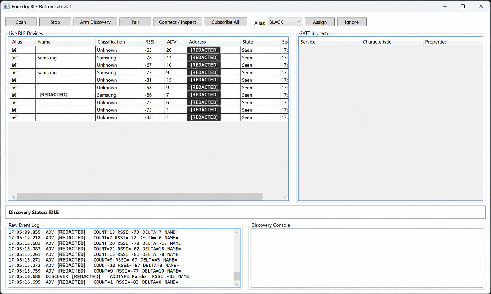

# Foundry BLE Button Lab

**Windows BLE discovery and GATT diagnostics**  
**Version:** v0.1 source snapshot | **Platform:** Windows 11 / .NET 10 WPF

Foundry BLE Button Lab is a small Windows desktop tool for exploring Bluetooth Low Energy advertisements and GATT characteristics while investigating inexpensive wireless button/tag devices for robotics projects.

The archived October 2026 build is a **known-good experimental BLE diagnostic baseline**. The original SXK/iSearching button tags did not pass functional validation, and no claim is made that this application is a working driver for those tags.

## Interface preview



*Illustrative, privacy-sanitized view of the v0.1 interface. Device identifiers and nearby-device information have been redacted. The screenshot is not evidence of acceptance testing of the sanitized source snapshot.*

## What it does

- Scan BLE advertisements; display device names, addresses, RSSI, hit counts and last-seen status.
- Inspect GATT services and characteristics on accessible devices.
- Subscribe to available Notify/Indicate characteristics and view raw diagnostic events.
- Arm a discovery workflow: establish a baseline, activate a candidate device, and observe a bounded 30-second identification window with signal/hit gating and GATT probing.
- Distinguish public and random BLE address types for Windows BLE resolution.
- Fingerprint advertisements by service UUID, manufacturer data and advertisement sections.
- Assign simple UI aliases or mark items as ignored.

## Build from source

Requires a Windows 11 PC with BLE hardware, the **.NET 10 SDK** and Windows desktop/WPF build support. The project targets `net10.0-windows10.0.26100.0`.

```powershell
cd src
dotnet build FoundryBLEButtonLab.csproj -c Release
```

Run the generated `FoundryBLEButtonLab.exe` from the appropriate Release output folder. This repository is **source only**; no compiled executable or third-party runtime DLLs are included. The published candidate has **not been rebuilt or retested** after sanitization, so its current build and runtime status remain unverified.

## Operating notes

1. Click **Scan** to observe local BLE traffic.
2. Select a device, then **Connect / Inspect** to enumerate GATT information where accessible.
3. Use **Subscribe All** to monitor supported Notify/Indicate characteristics.
4. For the button-discovery experiment, leave the target inactive during the baseline, choose **Arm Discovery**, then activate the target during the READY window. The historical UI calls the original test target **BLACK**; this is a retained experiment label, not a requirement for general BLE devices.

Bluetooth addresses—particularly random/private addresses—may change over time. Nearby BLE devices are often unrelated to the target under test. Scanning, pairing and probing must be used only on devices you own or are authorized to test.

## Source snapshot versus archived build

The original 2026-10-01 Library baseline included a `KnownNoise` filter with three local BLE addresses and three household device-name filters. To protect privacy, this public candidate removes the environment-specific filter contents and returns `false` from `KnownNoise` instead. **This can increase background candidate traffic and is a behavior change.** The original verified application and its preserved Library package have not been modified.

The initial hardware study found the SXK/iSearching tags unreliable or incompatible across repeated tests; the diagnostic tool itself proved useful for scanning other devices and resolving Bluetooth address types. See [Project background and verification boundaries](docs/PROJECT_NOTES.md) and [Third-party notes](docs/THIRD_PARTY_NOTICES.md).

## Scope and rights

Experimental development tool; not a certified device-control or safety system, not a production SXK/iSearching driver, and not guaranteed to work with every BLE device or Bluetooth adapter.

**License:** Foundry-owned source code is available under the [MIT License](LICENSE). Copyright (c) 2026 SymbioFoundry. The copyright and permission notices must be retained in copies or substantial portions of the software. Windows, .NET and other third-party components remain subject to their own terms. This license does not grant rights to third-party trademarks or software.
